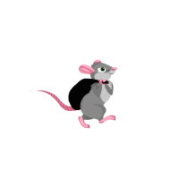
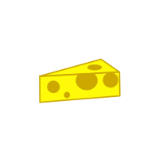
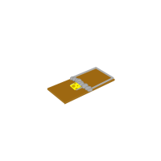
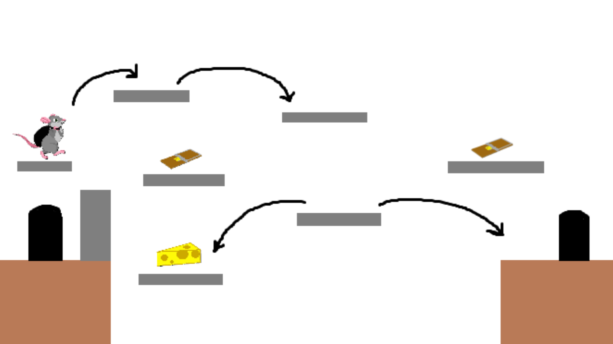

# Harjoitustyön suunnitelma

## Tietoja 

Tekijä: Noora Vepsäläinen

Työ git-varaston osoite: <https://gitlab.jyu.fi/vepsanew/ohj1ht> 

Pelin nimi: Henrin juustojahti

Pelialusta: Windows

Pelaajien lukumäärä: 1

## Pelin tarina

Henri on oleskellut kotikolossaan koko päivän. Hän kuitenkin tajuaa, että hänellä on todella kova nälkä ja hän tarvitsee jotakin ruokaa. 
Henrin lempiruoka on juusto ja hän päättää lähteä juustojahtiin. Kotikolonsa ulkopuolella häntä yritetään kuitenkin saada
kiinni hiirenloukuilla, mutta Henri tietää, että hän ei saa mennä niiden lähelle. Muuten Henri jää kiinni ja ei saa haluamaansa juustoa.
Henri tietää, ettei jaksa kantaa juustoa käsissään, joten hän ottaa jätesäkin mukaan ja lähtee etsimään juustoa!

## Pelin idea ja tavoitteet

Henrin täytyy siis etsiä juusto ja selvitä takaisin kotikoloonsa ilman, että hän jää kiinni hiirenloukkuihin. Kyseessä on 
tasohyppelypeli, jossa on mahdollisesti erilaisia tasoja. 

## Hahmotelma pelistä

## Toteutuksen suunnitelma

Helmikuu

- Luoda pelin pohja
- Saada hahmot peliin
- Saada miljöö rakennettua

Maaliskuu

- Saada hahmot liikkeelle
- Saada hahmot reagoimaan toisiinsa
- Saada peli toimimaan

Jos aikaa jää

- Tehdä lisää tasoja
- Hienosäätää pelin toimintaa
